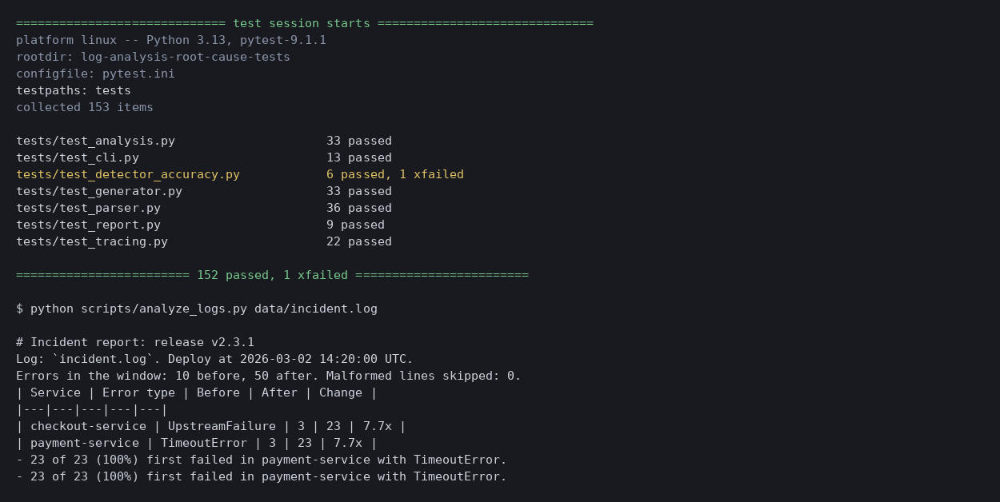

# Log Analysis Root Cause Tests

A small tool that reads application logs, finds the errors that started or jumped after a release, and traces which service failed first, plus the tests that check it. It does the kind of log reading I do when I hunt for a root cause: line up the errors against the deploy time, then follow one failing request across services.

The logs are synthetic. A seeded script generates them (`src/generator.py`), so every run gives the same result. The log format is my own, not Datadog's or any other tool's. Nothing here comes from a real system.

## What the tool does

1. **Parses** log lines (`timestamp level service key=value ...`). A malformed line is skipped and counted, never fatal.
2. **Compares** the 15 minutes before a deploy with the 15 minutes after, per service and error type. It flags an error type that has at least 10 errors after the deploy and is either new or at least 3x its count before. The minimum count stops a jump from 1 error to 3 from raising an alarm.
3. **Traces** a request across services and finds its root cause: the first error in the request's trace.
4. **Tallies** root causes for each flagged error type. A downstream error that always comes after an upstream one points at the upstream service.
5. **Writes** a markdown incident report. The CLI can exit with an error when it finds a regression (`--fail-on-spike`), so it can gate a pipeline.

Example output on `data/incident.log` (full report in `docs/incident_report.md`):

| Service | Error type | Before | After | Change |
|---|---|---|---|---|
| checkout-service | UpstreamFailure | 3 | 23 | 7.7x |
| payment-service | TimeoutError | 3 | 23 | 7.7x |

All 23 affected requests first failed in payment-service with TimeoutError. checkout-service only reported the symptom.

## What was tested

| Area | What the tests check |
|---|---|
| Parser | Every field, quoted messages with spaces, escaped quotes and `=` inside quotes, all four levels, tabs and extra spaces, 15 kinds of malformed line each rejected with a reason, blank lines ignored, line numbers of bad lines |
| Flag rule | A spike is flagged at exactly 3x and not at 2.75x; 9 errors are ignored and 10 are flagged; new error types; errors that stop or shrink are not flagged; each service and error type is judged on its own |
| Window edges | An error exactly at the deploy time counts as after; exactly one window before counts as before; exactly one window after is ignored |
| Tracing | Traces sorted by time, ties keep file order, root cause is the first error, requests with no errors, `since` and `until` limits on the tally |
| Generator | Same seed gives the same log, every generated line parses, lines are in time order, one deploy marker, every payment timeout is followed by a checkout failure one second later |
| Report and CLI | Report contents, example trace order, exit codes 0, 1 and 2, missing file, no deploy marker, unknown release, malformed lines counted, option handling, the two committed sample logs |
| Detector accuracy | False alarm and detection rates measured over many seeds, with floors so a worse detector fails the suite |

## How good is the detector?

The detector is statistical and the logs have random noise, so it is not perfect. I measured it on the generated logs. On 500 seeds it raised a false alarm on 3 clean logs and caught 492 of 500 incidents at 10x. The size of the incident matters a lot (50 seeds each):

| Payment timeout rate after the deploy | Detected |
|---|---|
| 1x (no incident) | 0 of 50 |
| 3x | 6 of 50 |
| 5x | 25 of 50 |
| 8x | 46 of 50 |
| 10x | 50 of 50 |

So a small incident can slip under the 10-error minimum. That is a deliberate choice: a lower minimum catches smaller incidents but raises more false alarms.

One false alarm is written as a test marked `xfail` (strict): in the clean log for seed 6, checkout-service had only 2 ValidationErrors before the deploy by chance and 13 after, which looks like a 6.5x spike. Ratios of small counts are noisy. If the detector is ever improved so this log passes, strict mode fails the run, which is the signal to remove the marker.

## Testing the tests

I broke the tool on purpose and confirmed the tests failed each time:

- changed `>=` to `>` in the ratio check (boundary tests failed),
- removed the minimum-count guard (4 tests failed),
- made the after window inclusive at its end (boundary test failed),
- made the root cause the last error instead of the first (13 tracing tests failed),
- let the parser accept lowercase levels (malformed-line test failed),
- lowered the default minimum count from 10 to 3 (detector accuracy tests failed).

One gap: lowering the default ratio threshold from 3 to 1.5 is **not** caught by the accuracy tests, because the minimum count already filters almost every false alarm in these logs. Only the exact-boundary tests in `test_analysis.py` guard the ratio.

## Results

152 tests pass and 1 is an expected failure. The suite takes about 20 seconds, most of it the detector accuracy tests that generate and analyze hundreds of logs. CI runs on GitHub Actions on every push. It also runs the analyzer on the clean log with `--fail-on-spike` (must pass) and on the incident log (writes the report as a build artifact).



## Tools

Python, pytest, GitHub Actions.

## How to run

```
pip install -r requirements.txt
python -m pytest
python scripts/analyze_logs.py data/incident.log
python scripts/analyze_logs.py data/clean.log --fail-on-spike
```

Options: `--release`, `--window` (minutes), `--ratio`, `--min-count`, `--report`, `--fail-on-spike`. Exit codes: 0 done, 1 regression found with `--fail-on-spike`, 2 file unreadable or no deploy marker.

To regenerate the sample logs: `python scripts/generate_sample_logs.py`.

## Project layout

```
src/log_parser.py            parse log lines, collect malformed ones
src/analysis.py              before/after comparison, tracing, root cause tally
src/generator.py             seeded synthetic log generator
src/report.py                markdown incident report
scripts/analyze_logs.py      command line tool
scripts/generate_sample_logs.py  writes the two sample logs
data/incident.log            sample log with an incident after the deploy
data/clean.log               sample log with no incident
tests/                       parser, analysis, tracing, generator, report, CLI and detector accuracy tests
docs/incident_report.md      report generated from the incident log
.github/workflows/tests.yml  CI
```
